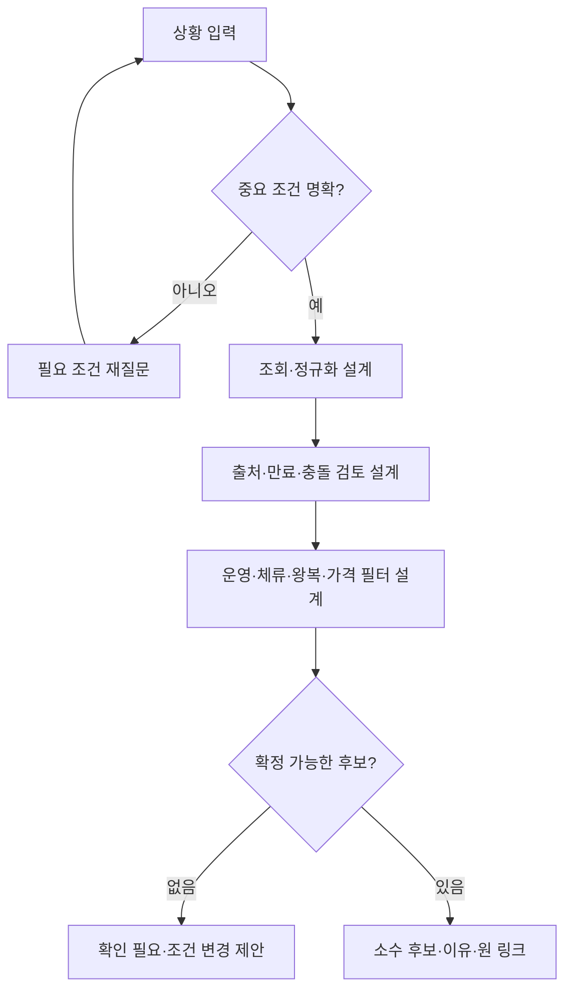

# CultureNow - 지금 갈 수 있는 공공활동을 찾는 서비스 기획

시간·위치·예산·예약 조건을 한 번에 비교해 오늘 실제로 가능한 문화·체육·관광 활동을 고르는 개인 기획 프로젝트입니다.

**현재 상태: 기획 완료 · MVP 미구현 · 27명 예비 수요조사 완료.** 도식은 설계이며 실제 API·추천 엔진의 실행 결과가 아닙니다.


[빠른 실행](#빠른-실행) · [결과](#결과) · [문제](#문제정의) · [구조](#아키텍처) · [상세 흐름](#상세-워크플로우) · [데이터](#데이터) · [시도](#시도와-개선) · [평가](#평가와-재현) · [한계](#한계) · [기여](#기여와-ai-활용)

## 빠른 실행

이 저장소에는 실행할 제품 서버가 없습니다. 저장소 루트에서 **설계 인용·판정 기록·설문 산술의 완결성**을 확인할 수 있습니다. Python 표준 라이브러리만 사용합니다.

```console
python evaluation/design-v1/run.py
python -m unittest discover -s evaluation/design-v1 -p "test_*.py"
```

2026-11-15 재실행: 설계 18개 인용·판정 기록 확인, 설문 산술 4/4 일치, 실행기 실패 검출 테스트 4개 통과. **설계 의미의 독립 심사나 추천 엔진 정확도가 아닙니다.** [기대 시나리오](evaluation/design-v1/cases.json), [결과 JSON](evaluation/design-v1/results.json), [설명](evaluation/design-v1/RESULTS.md)

## 결과

**목표 출력의 설계 예시**입니다. 가용 60분, 편도 25분·체류 20분·복귀 25분인 후보는 합계 70분이므로 제외합니다. 18:20 도착·18:30 폐관·30분 체류인 후보도 제외하도록 설계했습니다.

| 사용자가 알아야 할 것 | 설계한 결과 표시 | 구현·검증 상태 |
|---|---|---|
| 실제 이용 가능한가 | 시간·운영·가격·예약 조건과 판단 이유 | 설계 문서 검토, 엔진 미구현 |
| 정보가 확실한가 | 출처·확인 시각·확인 필요 상태 | API 연동 미실행 |
| 다음 행동은 무엇인가 | 원 안내·지도·예약 페이지 연결 | 실제 이용 전환 미측정 |

기존 설명 그림은 [서비스 흐름](assets/system-flow.png), [판단 엔진](assets/actionability-engine.png)에서 볼 수 있습니다. 작동 화면으로 소개하지 않습니다.

## 문제정의

공공활동 정보는 여러 기관에 있지만 사용자는 운영시간·이동·가격·예약을 직접 다시 확인해야 합니다. 인기나 취향이 맞아도 이미 문을 닫았거나 돌아올 시간이 없으면 실행할 수 없습니다. 후보를 많이 모으기보다 **명백히 불가능한 후보를 먼저 제외하는 판단**을 핵심으로 정했습니다.

## 아키텍처


| 설계 책임 | 제안한 분리 | 문서 근거 |
|---|---|---|
| 사용자 의도·설명 | 자연어 해석과 근거 문장화 | [아키텍처](docs/ARCHITECTURE.md) |
| 사실·판정 | API 사실, 출처·시각, Hard Filter와 동률 규칙 | [판단 규칙](docs/ARCHITECTURE.md) |
| 검증 | 문서 시나리오 검토와 향후 MVP 실험 구분 | [검증 계획](docs/VALIDATION.md) |

위 구성 요소는 구현된 모듈·API가 아니라 제안 구조입니다.

## 상세 워크플로우



| 단계 | 설계한 판단 규칙 | 예외 처리와 검증할 것 |
|---|---|---|
| 1. 조건 구조화 | 위치, 가용 시간, 예산, 동행, 복귀 여부·시각·장소를 나눔 | 확정할 수 없는 값을 임의로 채우지 않고 중요한 조건만 질문 |
| 2. 사실 조회·정규화 | 활동 ID·좌표·운영 일정·가격·예약·출처·시각을 공통 필드로 맞춤 | 누락 가격을 무료, 빈 예약정보를 예약 불필요로 바꾸지 않음 |
| 3. 정보 검토 | 원천 갱신·확인 시각과 유효기간을 검사. 기관 상세·공식 API·공공 집계 순으로 충돌 검토 | 양쪽 값·시각 보존. 충돌이 해결되지 않으면 확인 필요 |
| 4. 실행 가능성 | 도착뿐 아니라 체류 완료가 폐관 이내인지 검사. 복귀 요청은 왕복 이동까지 합산 | 자정 넘는 영업은 시작일·종료일·현지 시간대로 계산하고 임시 휴관 우선 |
| 5. 점수와 표시 | 불가능 후보를 제외한 뒤 시간·이동·예산·신뢰도 등으로 점수화 | 0~1 점수 차이 0.01 이하는 기준점 기반 동률 구간. 표시 순서와 정책 버전 기록 |
| 6. 설명과 연결 | 판정에 쓴 사실만 설명하고 출처·기준 시각과 원 링크를 표시 | 모델이 운영시간·가격을 생성하지 않음. 클릭을 실제 이용 완료로 집계하지 않음 |

예를 들어 가용 60분에 편도 25분·체류 20분·복귀 25분이면 총 70분이므로 제외합니다. 18:20 도착·18:30 폐관·최소 체류 30분인 후보도 제외합니다. 이동시간 조회가 실패했는데 편도를 조용히 두 배로 추정하지 않도록 설계했습니다. 구체 규칙은 [서비스 아키텍처](docs/ARCHITECTURE.md)에 있습니다.

## 데이터

| 검토 데이터 | 설계한 활용 | 아직 필요한 확인 |
|---|---|---|
| 문화포털·KOPIS·TourAPI | 전시·공연·관광 후보 | 실제 필드·제공 범위·이용 조건 |
| 체육시설·공유누리 | 시설·강좌·개방 자원 | 예약·가격·운영일 결측과 갱신 |
| 지도·교통·날씨 | 이동·왕복·야외 적합성 | API 장애·시간대·비용 |
| 공통 활동 필드 | ID·좌표·일정·가격·예약·출처·시각 | 원천 간 충돌·정규화 품질 |
| 예비 수요조사 27명 | 문제·의향의 탐색 | 비대표 표본, 실제 이용 행동 미측정 |

가격·운영·예약이 비어 있다고 무료·운영 중·예약 불필요로 바꾸지 않도록 설계했습니다. 실제 수집 데이터셋·추천 학습 모델은 없습니다. [검증 계획](docs/VALIDATION.md)

## 시도와 개선

| 기획에서 발견한 문제 | 선택한 접근 | 아직 확인하지 못한 부분 |
|---|---|---|
| 여러 사이트를 오가는 확인 비용 | 한 문장에서 상황을 받고 소수의 실행 가능 후보로 압축 | 기존 검색보다 실제 결정 시간이 줄어드는가 |
| LLM이 가격·운영을 지어낼 위험 | 해석·설명과 API 사실·규칙 판정을 분리 | API 필드 채움률·갱신 품질과 실제 생성 신뢰성 |
| 도착만 확인하면 체류·귀가가 불가능 | 체류 완료·왕복·입장 마감·자정 경계를 명시 | 실지역 데이터로 자동 판정했을 때 거짓 양성과 누락률 |
| 출처·시각·정렬 규칙이 빠진 설계 | 유효기간·충돌 우선순위·동률 기준을 문서화 | 임계값은 설계 기본값이며 실측 최적값이 아님 |
| 처음부터 전국 확장의 복잡성 | 한 지역·2~3개 소스로 MVP를 제한하는 단계 계획 | 실제 구현·사용성·이용 전환·운영 비용 |

## 평가와 재현

| 확인 종류 | 대상·결과 | 근거 | 한계 |
|---|---|---|---|
| 기존 예비조사 | 불편·초기 의향 각 20/27(74.1%), 소수 후보 19/27(70.4%), 연결 긍정 22/27(81.5%) | [기존 조사 설명](README_HISTORY.md) | 의향이며 실제 시장 수요·전환 아님 |
| 설계 기록 재확인 | 2026-11-15: 18개 SUPPORTED·근거 인용 18/18, 산술 4/4 | [입력·판정](evaluation/design-v1/cases.json), [결과](evaluation/design-v1/results.json) | AI가 기존 문서를 본 뒤 내린 검토 판정의 완결성 검사 |
| 실행기 회귀 | 실패 판정·인용 누락 등의 검출 테스트 4개 통과 | [test_review_gate.py](evaluation/design-v1/test_review_gate.py) | 설계 타당성·제품 성능을 검증하지 않음 |

수정 전에는 명시 12·부분 3·누락 3이었고 설계 보완 뒤 명시 18로 대조했습니다. [이전 기록](evaluation/design-v1/baseline/RESULTS.md), [현재 검토 범위](evaluation/design-v1/RESULTS.md)를 보존합니다. 사람 독립 심사는 대기이며 실제 추천·사용성·현장 이용 평가는 미실행입니다.

## 한계

| 미검증·한계 | 영향 | 다음 확인 |
|---|---|---|
| MVP·API 수집 미구현 | 자동 추천·갱신 품질을 주장할 수 없음 | 한 지역·2~3개 소스 MVP |
| 문서로 정한 TTL·동률 기준 | 현장 최적값이 아님 | 실제 오류·이용 사례로 검증 |
| 작은 예비 의향 표본 | 행동·시장 수요로 일반화 불가 | 실제 탐색 시간·이용 전환 비교 |
| API 가격·예약·이동 결측 | 불가능 후보를 추천할 위험 | 결측·충돌·장애 정책 실험 |
| B2G·B2B·B2C 사업 가설 | 수익 성과 없음 | 기관·사용자 가설 검증 |

[단계별 완료 기준](docs/ROADMAP.md)에 다음 검증을 정리했습니다.

## 기여와 AI 활용

문제 정의·공공데이터 조사·비교 분석·서비스 구조·예비조사·사업/KPI·MVP 검증 계획을 수행했습니다. 제품의 LLM 활용은 제안 단계입니다. 문서 보완·설계 시나리오 대조·검증 실행기에 AI 코딩 도구를 활용했으며(ai-assisted), 실제 제품을 개발·운영한 성과로 표시하지 않습니다.

## 상세 문서와 이전 기록

[설계 아키텍처](docs/ARCHITECTURE.md) · [검증 계획](docs/VALIDATION.md) · [로드맵](docs/ROADMAP.md) · [기여·AI 활용](docs/APPLICATION_PORTFOLIO.md)

[이전 README 전체 기록](README_HISTORY.md)은 기존 시연·설치·기술 스택·기능별 기록과 측정 조건을 보존한 스냅샷입니다. 현재 실행 경계와 새 문서의 기준은 위 본문을 따릅니다. 이번 변경은 공개 코드·문서·평가 대조에 AI 코딩 도구를 사용했습니다(ai-assisted). 자동 병합하지 않습니다.
