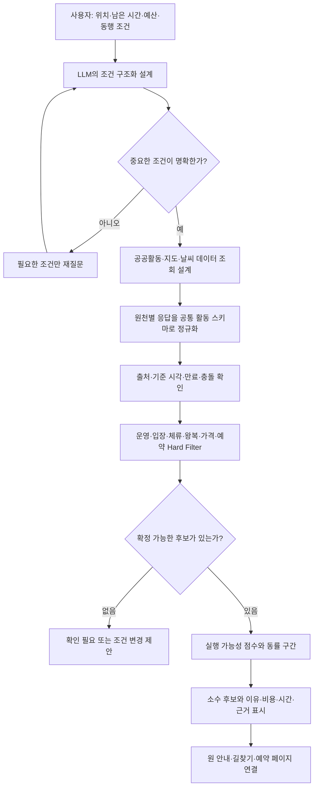
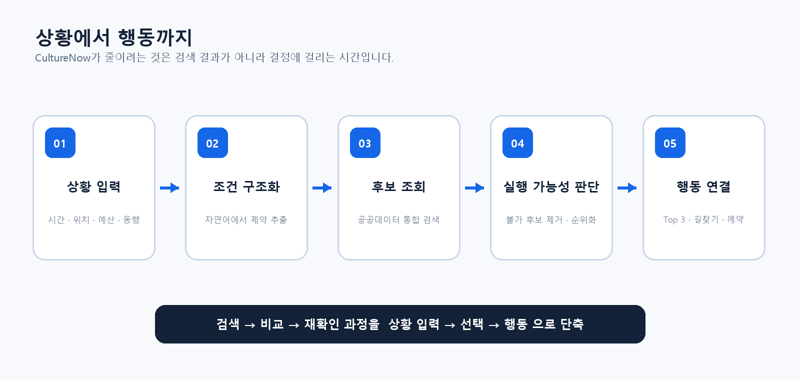
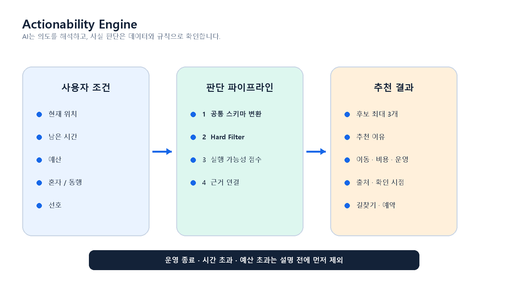
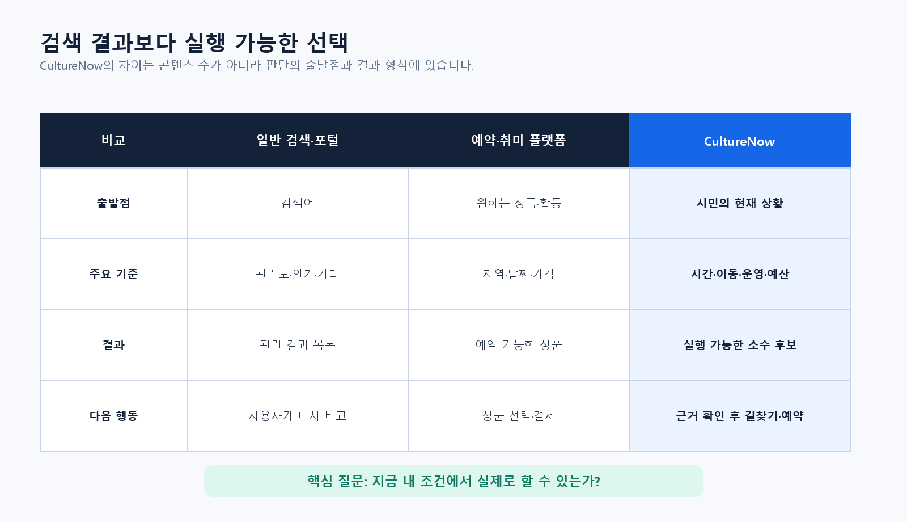

# CultureNow - 지금 갈 수 있는 공공활동을 찾는 서비스 기획

시간·위치·예산·예약 조건을 한 번에 비교해 오늘 실제로 가능한 문화·체육·관광 활동을 고르는 개인 기획 프로젝트입니다.

**현재 상태: 기획 완료 · MVP 미구현 · 27명 예비 수요조사 완료.** 아래 워크플로우는 설계이며 실제 API·추천 엔진이 실행된 결과가 아닙니다. 경력기술서와 별개로 이 저장소에서는 기획 과정과 아직 검증하지 못한 가설을 공개합니다.

[설계 워크플로우](#설계-워크플로우) · [문제와 해결 과정](#문제와-해결-과정) · [검토 결과와 한계](#검토-결과와-한계) · [아키텍처](docs/ARCHITECTURE.md) · [검증 계획](docs/VALIDATION.md)

## 어떤 문제였나

공공활동 정보는 여러 기관에 있지만 사용자는 운영시간·이동·가격·예약을 직접 다시 확인해야 합니다. 인기나 취향이 맞아도 이미 문을 닫았거나 돌아올 시간이 없으면 실행할 수 없습니다. 후보를 많이 모으기보다 **명백히 불가능한 후보를 먼저 제외하는 판단**을 핵심으로 정했습니다.

## 설계 워크플로우

| 단계 | 설계한 판단 규칙 | 예외 처리와 검증할 것 |
|---|---|---|
| 1. 조건 구조화 | 위치, 가용 시간, 예산, 동행, 복귀 여부·시각·장소를 나눔 | 확정할 수 없는 값을 임의로 채우지 않고 중요한 조건만 질문 |
| 2. 사실 조회·정규화 | 활동 ID·좌표·운영 일정·가격·예약·출처·시각을 공통 필드로 맞춤 | 누락 가격을 무료, 빈 예약정보를 예약 불필요로 바꾸지 않음 |
| 3. 정보 검토 | 원천 갱신·확인 시각과 유효기간을 검사. 기관 상세·공식 API·공공 집계 순으로 충돌 검토 | 양쪽 값·시각 보존. 충돌이 해결되지 않으면 확인 필요 |
| 4. 실행 가능성 | 도착뿐 아니라 체류 완료가 폐관 이내인지 검사. 복귀 요청은 왕복 이동까지 합산 | 자정 넘는 영업은 시작일·종료일·현지 시간대로 계산하고 임시 휴관 우선 |
| 5. 점수와 표시 | 불가능 후보를 제외한 뒤 시간·이동·예산·신뢰도 등으로 점수화 | 0~1 점수 차이 0.01 이하는 기준점 기반 동률 구간. 표시 순서와 정책 버전 기록 |
| 6. 설명과 연결 | 판정에 쓴 사실만 설명하고 출처·기준 시각과 원 링크를 표시 | 모델이 운영시간·가격을 생성하지 않음. 클릭을 실제 이용 완료로 집계하지 않음 |

예를 들어 가용 60분에 편도 25분·체류 20분·복귀 25분이면 총 70분이므로 제외합니다. 18:20 도착·18:30 폐관·최소 체류 30분인 후보도 제외합니다. 이동시간 조회가 실패했는데 편도를 조용히 두 배로 추정하지 않도록 설계했습니다. 구체 규칙은 [서비스 아키텍처](docs/ARCHITECTURE.md)에 있습니다.

## 문제와 해결 과정

| 기획에서 발견한 문제 | 선택한 접근 | 아직 확인하지 못한 부분 |
|---|---|---|
| 여러 사이트를 오가는 확인 비용 | 한 문장에서 상황을 받고 소수의 실행 가능 후보로 압축 | 기존 검색보다 실제 결정 시간이 줄어드는가 |
| LLM이 가격·운영을 지어낼 위험 | 해석·설명과 API 사실·규칙 판정을 분리 | API 필드 채움률·갱신 품질과 실제 생성 신뢰성 |
| 도착만 확인하면 체류·귀가가 불가능 | 체류 완료·왕복·입장 마감·자정 경계를 명시 | 실지역 데이터로 자동 판정했을 때 거짓 양성과 누락률 |
| 출처·시각·정렬 규칙이 빠진 설계 | 유효기간·충돌 우선순위·동률 기준을 문서화 | 임계값은 설계 기본값이며 실측 최적값이 아님 |
| 처음부터 전국 확장의 복잡성 | 한 지역·2~3개 소스로 MVP를 제한하는 단계 계획 | 실제 구현·사용성·이용 전환·운영 비용 |

## 검토 결과와 한계

예비조사 27명 중 탐색 불편 경험 20명(74.1%), 초기 이용 의향 긍정 20명(74.1%), 소수 후보 선호 19명(70.4%), 지도·예약 연결 긍정 22명(81.5%)이었습니다. 작은 비대표 표본의 의향 조사이며 실제 행동·시장 수요를 입증하지 않습니다.

[18개 설계 시나리오 검토](evaluation/design-v1/RESULTS.md)는 첫 검토의 명시 12·부분 3·누락 3을 보완해 18/18 명시로 대조한 기록입니다. 자동 실행기는 AI 판정과 인용·산술의 완결성을 확인하며, 설계 의미의 독립 심사나 실제 엔진 정확도 평가가 아닙니다. [수정 전 기록](evaluation/design-v1/baseline/RESULTS.md)도 보존했습니다.

실제 API 수집, 추천 엔진, 사용성 비교, 현장 이용 전환은 아직 수행되지 않았습니다. B2G·B2B·B2C 수익모델도 가설입니다. [검증 계획](docs/VALIDATION.md)과 [단계별 완료 기준](docs/ROADMAP.md)에서 다음에 확인할 내용을 볼 수 있습니다.

## 개인 기여와 AI 활용

문제 정의·공공데이터 조사·비교 분석·서비스 구조·예비조사·사업/KPI·MVP 검증 계획을 수행했습니다. 제품의 LLM 활용은 제안 단계입니다. 문서 보완·설계 시나리오 대조·검증 실행기에 AI 코딩 도구를 활용했으며(ai-assisted), 실제 제품을 개발·운영한 성과로 표시하지 않습니다.

---

원래 기획 설명·예비조사·사업 가설·로드맵 펼치기

[지원용 프로젝트 설명](docs/APPLICATION_PORTFOLIO.md)에 기여·AI 활용과 검증 범위를 정리했습니다. 신규 [18개 설계 시나리오 검토](evaluation/design-v1/RESULTS.md)는 **설계 보완 후 18/18 명시·부분 0개·누락 0개**입니다. MVP가 없는 상태에서 시행한 문서 검토이며 제품 성능 점수가 아닙니다.

> 흩어진 공공 문화·체육·관광 정보를 모아, **지금 내 조건에서 실제로 할 수 있는 활동**을 골라주는 GovTech 서비스 기획

CultureNow는 공연이나 시설 목록을 한곳에 모으는 데서 출발하지 않았습니다. 일정 사이에 두 시간이 남았을 때 여러 사이트를 오가며 운영시간과 이동거리를 다시 확인했던 경험이 먼저였습니다. 그때 필요한 것은 더 많은 검색 결과가 아니라, **지금 갈 수 있는 곳 몇 개**를 추려주는 일이라고 보았습니다.

이 저장소는 2026 GovTech 창업경진대회 아이디어 기획 분야에 제출한 내용을 포트폴리오 형태로 다시 정리한 것입니다. 아직 구현된 제품은 아니며, 문제 정의와 데이터 구조, 판단 로직, 사업화 가설, 검증 계획을 담고 있습니다.

## 문제를 이렇게 정의했습니다

공공 문화·체육·관광 정보가 부족한 것은 아니었습니다. 문제는 그다음이었습니다. 시민이 실제로 이용하려면 문화포털, 공연·관광 정보, 체육시설, 지도, 날씨, 예약 페이지를 오가며 다음 내용을 직접 확인해야 합니다.

- 오늘 운영하는가
- 남은 시간 안에 이동하고 이용할 수 있는가
- 예산 안에 들어오는가
- 예약이 필요한가
- 혼자 참여할 수 있는가

그래서 CultureNow는 정보를 더 모으는 것보다 **검색과 비교에 드는 의사결정 비용**을 줄이는 쪽에 초점을 맞췄습니다.

## 제안하는 방식

사용자는 필터를 하나씩 고르는 대신 평소 말하듯 상황을 입력합니다.

> 오늘 저녁 부산에서 두 시간 정도 시간이 남았어. 혼자 갈 수 있고 2만 원 이하면 좋겠어.

서비스는 문장에서 시간, 위치, 예산, 동행 여부와 선호를 구조화합니다. 이후 공공데이터에서 후보를 찾고, 조건에 맞지 않는 활동을 제외한 뒤 실행 가능성이 높은 순서로 세 가지 안팎의 선택지를 제시합니다. 추천 이유와 함께 이동시간, 비용, 운영 여부, 예약 링크도 보여줍니다.

## Actionability Engine

처음에는 취향을 잘 맞히는 추천이 중요하다고 생각했습니다. 하지만 운영이 끝났거나 남은 시간 안에 갈 수 없는 장소라면 취향이 맞아도 좋은 추천이 아닙니다. 그래서 **실행 불가능한 후보를 먼저 걷어내는 판단 과정**을 핵심으로 잡았습니다.

1. 자연어에서 사용자 조건을 추출합니다.
2. 공공 API와 외부 API에서 사실 정보를 조회합니다.
3. 운영 종료, 시간 초과, 예산 초과처럼 명확히 맞지 않는 후보를 제거합니다.
4. 이동 부담, 선호도, 날씨, 예약 편의 등을 점수화합니다.
5. 근거와 출처를 붙여 소수의 후보만 설명합니다.

LLM에 추천 과정을 전부 맡기는 방식도 검토했습니다. 하지만 시설의 존재, 운영시간, 가격처럼 틀리면 바로 사용자 불편으로 이어지는 정보까지 생성형 AI가 판단하게 두는 것은 위험하다고 봤습니다. LLM은 의도를 해석하고 결과를 설명하는 역할을 맡고, 사실 정보는 데이터에서 확인합니다. 데이터가 오래되었거나 비어 있다면 그럴듯하게 채우지 않고 기준 시점과 `확인 필요` 상태를 보여줍니다.

자세한 판단 단계와 예외 처리는 [서비스 아키텍처](docs/ARCHITECTURE.md)에 정리했습니다.

## 데이터 구성

| 영역 | 검토 데이터 | 쓰임 |
|---|---|---|
| 문화 | 문화포털 및 문화 공공데이터 | 전시·행사·체험·시설 후보 |
| 공연 | KOPIS Open API | 공연 목록과 상세 정보 |
| 관광 | TourAPI | 관광지·축제·지역 행사 |
| 체육 | 전국체육시설 관련 Open API | 생활체육시설 위치와 유형 |
| 공공자원 | 공유누리 Open API | 공간·강좌·체육시설 등 개방 자원 |
| 환경 | 기상 데이터, 지도·교통 API | 야외 적합성, 거리와 이동시간 |

기관마다 응답 형식이 달라 그대로는 같은 기준으로 비교하기 어렵습니다. 그래서 `activity_id`, `name`, `location`, `operating_hours`, `price`, `reservation_required`, `source`, `updated_at` 같은 공통 필드로 맞춥니다. 갱신주기도 원천마다 다르기 때문에 결과에는 출처와 확인 시각을 함께 보여주도록 정했습니다.

## 기존 서비스와 다른 지점

CultureNow의 차이는 콘텐츠를 더 많이 보유하는 데 있지 않습니다.

- 검색어가 아니라 **사용자의 현재 상황**에서 시작합니다.
- 문화, 체육, 관광을 구분해서 찾지 않고 한 번에 비교합니다.
- 인기나 취향뿐 아니라 시간·이동·운영·비용처럼 행동을 막는 조건을 먼저 봅니다.
- 결과를 나열하지 않고, 왜 지금 가능한지 설명한 뒤 길찾기와 예약으로 연결합니다.

## 예비 검증

일반인 27명을 대상으로 문제 경험과 초기 이용 의향을 물었습니다. 표본이 작기 때문에 시장 전체를 설명하는 수치로 보지는 않았습니다. 대신 첫 MVP에서 무엇부터 확인해야 할지 순서를 잡는 자료로 사용했습니다.

| 질문 | 결과 |
|---|---:|
| 정보를 한 번에 확인하기 어렵거나 추가 확인을 해본 경험 | 20명 / 27명 (74.1%) |
| 상황 기반 추천 서비스 이용 의향 긍정 | 20명 / 27명 (74.1%) |
| 많은 목록보다 소수 후보로 압축한 방식 선호 | 19명 / 27명 (70.4%) |
| 지도·길찾기·예약 연결이 필요하거나 유용 | 22명 / 27명 (81.5%) |

추천 조건에서는 위치·이동시간(77.8%)과 이용 가능 시간·운영시간(70.4%)이 가장 많이 선택되었습니다. 이 결과를 보고 취향 추천보다 시간과 이동 가능성을 먼저 검증하기로 했습니다. 설문을 어떻게 해석했고 다음에 무엇을 확인할지는 [검증 계획](docs/VALIDATION.md)에 적었습니다.

## 사업화 가설

시민이 공공서비스를 찾는 기본 기능까지 유료로 묶는 것은 서비스 취지와 맞지 않는다고 봤습니다. 탐색과 추천은 무료 제공을 기본으로 두고, 공공서비스 접근성을 해치지 않는 범위에서 수익모델을 검토했습니다.

- **B2G**: 지자체·공공기관용 통합 추천, 저이용 자원 분석, 지역 수요 대시보드
- **B2B**: 예약·체험 서비스 연결, 추천 API, 이용 전환 기반 제휴
- **B2C**: 기본 추천은 무료로 제공하고, 초기 핵심 수익원으로 전제하지 않음

아직 확정된 사업모델은 아닙니다. 어떤 전제를 확인해야 하는지와 예상되는 위험은 [사업·KPI 문서](docs/BUSINESS_AND_KPI.md)에 따로 적었습니다.

## 다음 단계

첫 MVP부터 전국 데이터를 다루면 데이터가 많아지는 만큼 오류의 원인도 찾기 어려워집니다. 그래서 한 지역에서 2~3개 데이터 소스만 연결하고 다음 질문부터 확인하려 합니다.

1. 서로 다른 데이터에서 운영시간·가격·예약정보를 안정적으로 맞출 수 있는가
2. 규칙 기반 필터만으로 명백히 불가능한 후보를 얼마나 제거할 수 있는가
3. 사용자가 추천 이유를 이해하고 실제 길찾기나 예약으로 이동하는가
4. 기존 검색보다 활동 결정까지 걸리는 시간이 줄어드는가

구현 순서와 단계별 완료 기준은 [로드맵](docs/ROADMAP.md)에 정리했습니다.

## 문서 안내

| 문서 | 내용 |
|---|---|
| [문제와 해결 방향](docs/PROBLEM_AND_SOLUTION.md) | 문제를 좁혀 온 과정, 사용자 흐름, 기능 범위 |
| [서비스 아키텍처](docs/ARCHITECTURE.md) | 데이터 정규화, 판단 파이프라인, 실패 처리 |
| [사업·KPI](docs/BUSINESS_AND_KPI.md) | 이해관계자별 가치, 사업 가설, 성과지표 |
| [검증 계획](docs/VALIDATION.md) | 27명 예비조사, 한계, 후속 실험 |
| [개발 로드맵](docs/ROADMAP.md) | 지역 단위 MVP부터 실증까지의 순서 |
| [비식별 원본 기획서](original/CultureNow_idea_plan_redacted.pdf) | 제출 기획서 본문, 문서 메타데이터 제거본 |

## 현재 상태

`기획 완료 · MVP 미구현 · 예비 수요조사 완료`

이 저장소는 완성 제품의 성능을 주장하지 않습니다. 실제 API의 품질과 갱신주기, 실행 가능성 점수의 정확도, 지역별 데이터 편차, 동행 기능의 안전성과 운영비용은 앞으로 검증해야 할 항목입니다.

**개인 수행 범위:** 문제 정의 · 공공데이터/API 조사 · 경쟁 서비스 분석 · 서비스 아키텍처 설계 · Actionability Engine 개념 설계 · 사용자 예비조사 · 사업모델·KPI 설계 · MVP 실증 계획 수립

---

**한 문장으로 정리하면:** CultureNow는 공공정보를 더 많이 보여주는 서비스가 아니라, 사용자의 시간과 위치 안에서 **오늘 실제로 할 수 있는 선택**으로 바꾸는 서비스입니다.

