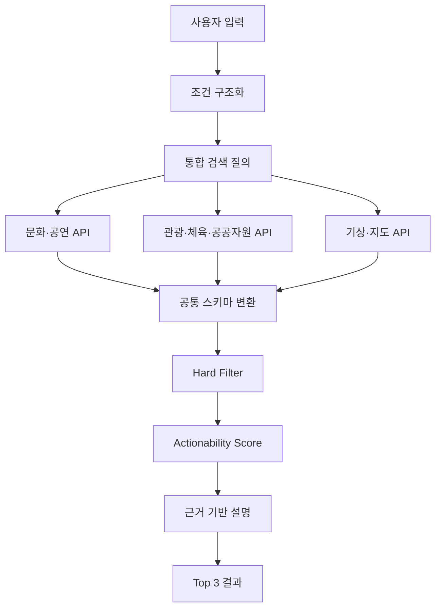

# 서비스 아키텍처

## 설계 목표

처음에는 LLM이 추천 과정 대부분을 맡는 방식도 생각했습니다. 하지만 운영시간이나 가격처럼 틀리면 바로 사용자 불편으로 이어지는 정보까지 생성형 AI에 맡기는 것은 위험하다고 봤습니다. 그래서 자연어 해석, 사실 조회, 규칙 판정, 결과 설명을 나눠 설계했습니다. 이렇게 나눠야 잘못된 결과가 나왔을 때 어느 단계에서 문제가 생겼는지도 확인할 수 있습니다.



## 1. 사용자 조건 구조화

사용자가 입력한 문장을 그대로 검색에 넣기보다, 검색과 판정에 필요한 조건으로 먼저 풀어냅니다.

```json
{
  "location": "부산",
  "available_from": "2026-09-30T18:00:00+09:00",
  "available_minutes": 120,
  "budget_max": 20000,
  "party": "solo",
  "preferences": ["indoor_or_weather_safe"]
}
```

문장에서 값을 확정하기 어렵다고 해서 임의로 채우지는 않습니다. `null`과 신뢰도를 남기고, 답에 큰 영향을 주는 조건만 사용자에게 다시 묻습니다. 질문을 너무 많이 하면 검색보다 더 번거로운 서비스가 되기 때문입니다.

## 2. 공통 활동 스키마

기관별 API는 이름도 형식도 서로 다릅니다. 판정 단계에서 매번 원천별 예외를 다루지 않도록 아래 공통 필드에 맞춥니다.

| 필드 | 설명 |
|---|---|
| `activity_id` | 원천과 원본 식별자를 조합한 내부 키 |
| `name`, `category` | 활동명과 표준 분류 |
| `location` | 주소와 좌표 |
| `operating_period` | 행사·프로그램 운영 기간 |
| `operating_hours` | 요일별 이용 가능 시간 |
| `price` | 무료 여부, 최소·최대 비용 |
| `reservation_required` | 예약 필수·선택·확인 필요 |
| `indoor_outdoor` | 실내·야외·혼합 |
| `information_url` | 원 안내 페이지 |
| `reservation_url` | 원 예약 페이지 |
| `source`, `updated_at` | 출처와 데이터 기준 시각 |

원천 필드가 비어 있다고 해서 `0`, `무료`, `예약 불필요`로 바꾸지는 않습니다. 빈 값을 편의상 확정값으로 바꾸면 실제로는 예약이 필요한 활동을 그대로 추천할 수 있습니다. 그래서 `unknown` 상태를 유지하고, 모르는 정보가 있다는 사실도 판단에 반영합니다.

## 3. Hard Filter

점수를 아무리 정교하게 계산해도 이미 문을 닫았거나 예산을 넘긴 후보는 추천할 이유가 없습니다. 이런 명확한 제약은 순위를 매기기 전에 처리합니다.

- 운영 기간이 지남
- 도착 전에 운영이 끝남
- 이동과 최소 체류시간을 합치면 가용 시간을 초과함
- 최소 비용이 예산을 초과함
- 휴관 또는 매진이 확인됨
- 필수 예약의 마감이 지남

정보가 없다는 이유만으로 무조건 탈락시키지는 않습니다. 데이터가 덜 채워졌다는 이유만으로 이용 가능한 후보까지 사라질 수 있기 때문입니다. 대신 결과에 `확인 필요`를 붙이고 신뢰도 점수에서 감점합니다.

### 체류 종료와 복귀 시간

도착할 수 있다는 사실만으로 이용 가능하다고 보지 않습니다. `도착 시각 + 최소 체류시간 <= 폐관 시각`이어야 합니다. 18:20 도착, 18:30 폐관, 최소 체류 30분인 후보는 제외합니다. 체류를 마치는 시각과 폐관 시각이 정확히 같으면 허용하되, 별도 입장 마감이 있으면 도착 시각이 입장 마감보다 늦지 않아야 합니다. 최소 체류시간이나 폐관 정보를 모르면 가능하다고 확정하지 않고 `확인 필요`로 남깁니다.

이동시간은 기본적으로 현재 위치에서 후보까지의 편도 시간입니다. 사용자 조건에 `return_required`와 `return_by`, `return_location`을 별도로 둡니다. 복귀가 필요하면 `가는 시간 + 최소 체류시간 + 돌아오는 시간 <= 가용 시간`과 복귀 마감 시각을 모두 확인합니다. 왕복을 요청했는데 복귀 위치나 마감이 빠졌다면 해당 조건만 다시 묻습니다. 가용 60분, 편도 25분, 체류 20분, 돌아오는 시간 25분이면 합계 70분이므로 제외합니다. 돌아오는 시간을 조회하지 못했다면 편도 시간을 그대로 두 배로 추정하지 않고 `확인 필요`로 표시하며 확정 가능한 후보의 순위에서 제외합니다.

### 자정을 넘는 운영과 예외 영업일

모든 시각은 원천의 현지 시간대와 날짜를 포함한 값으로 해석하며, 국내 후보의 기본 시간대는 `Asia/Seoul`입니다. 요일별 운영시간은 영업 시작일에 연결합니다. 종료 시각이 시작 시각보다 이르면 종료일을 다음 날로 계산합니다. 시작·종료 시각이 같으면 24시간 운영이라고 가정하지 않고 확인을 요청합니다.

예를 들어 22:00~02:00 영업은 시작일 22:00부터 다음 날 02:00까지입니다. 23:30 출발하여 다음 날 00:30에 체류를 마치는 후보는 같은 영업 구간 안인지 확인합니다. 다음 날의 새 영업과 전날에서 이어지는 영업 구간을 모두 검사합니다. 날짜별 임시 휴관·특별 영업시간이 있으면 주간 반복 일정 대신 해당 날짜의 예외 일정을 우선 적용합니다. 예외가 휴관인지 전날 야간 영업 중단까지 포함하는지 불분명하면 자의적으로 이어 붙이지 않고 `확인 필요`로 남깁니다. 원천이 명시한 운영 종료일 이후까지 영업을 연장하지 않습니다.

### 데이터 유효기간과 출처 충돌

아래 기간은 실측한 원천 품질이 아니라 첫 MVP를 검증하기 위한 설계 기본값입니다. 원천이 더 짧은 유효기간을 명시하면 그 값을 우선합니다. `updated_at`과 원천을 확인한 시각 `checked_at`을 함께 남기고, 후보 평가 시각 기준으로 둘 중 더 오래된 시각에서 경과한 시간이 유효기간을 넘으면 `확인 필요`로 표시합니다. 시각이 없거나 미래 시각이면 최신으로 간주하지 않습니다.

| 정보 | 기본 유효기간 | 기간 초과 시 처리 |
|---|---|---|
| 운영시간·가격·행사 일정 | 24시간 | 재조회 전에는 확정 추천으로 분류하지 않음 |
| 예약 가능·잔여석·매진 | 5분 | 예약 링크에서 재확인하도록 안내, 예약 가능으로 확정하지 않음 |
| 이동시간·날씨 | 15분 | 다시 조회하며 실패하면 순위 산정에서 제외 |
| 주소·좌표·시설 기본 정보 | 30일 | 원 제공기관에서 재확인 |

가격이 60일 전에 확인되었다면 24시간을 넘었으므로 `확인 필요`입니다. 단순히 새로 다운로드한 시각만으로 오래된 원천 정보를 최신으로 갱신하지 않습니다.

동일 후보의 같은 이용일·대상·요금 조건에서 정보가 충돌하면 자동으로 합치지 않고 양쪽 값·출처·기준 시각을 보존합니다. 운영기관의 해당 날짜 공식 상세·예약 안내를 우선 검토하고, 그다음 같은 기관의 공식 API, 다른 공공 집계 API 순으로 확인합니다. 같은 우선순위에서는 유효기간 안에 있는 최신 원천 정보를 사용합니다. 우선 출처도 만료되었거나 대상·날짜가 다르면 충돌을 해결했다고 처리하지 않습니다. API는 무료이고 기관 상세는 유료라면 기관 상세의 금액과 시각을 먼저 확인하되, 확인 전에는 `가격 충돌·확인 필요`로 표시하고 무료라고 설명하지 않습니다.

## 4. 실행 가능성 점수

첫 버전부터 학습 모델을 쓰면 점수가 왜 그렇게 나왔는지 설명하기 어렵습니다. 초기 점수는 조건별 영향을 확인할 수 있는 가중 합으로 시작합니다.

```text
score = 시간 적합도
      + 이동 부담
      + 예산 적합도
      + 운영정보 신뢰도
      + 날씨 적합도
      + 사용자 선호
      + 예약 편의성
```

가중치는 처음부터 정답을 정할 수 있는 값이 아닙니다. 최초 MVP에서는 사용자의 선택 여부와 실제 이용 연결을 기록하고, 어떤 조건이 결과 선택에 영향을 주었는지 본 뒤 조정합니다.

### 동률의 기준과 표시 순서

비교할 점수는 0~1 범위로 정규화하고, 0.01 이하의 차이는 같은 순위 구간으로 봅니다. 점수 0.800과 0.799의 차이 0.001은 동률 구간이며 추천 우열을 설명하지 않습니다. 원 점수 내림차순으로 정렬한 뒤, 아직 구간에 배정하지 않은 최고 점수를 기준점으로 삼아 그 점수와의 차이가 0.01 이하인 후보만 한 구간으로 묶습니다. 이 방식으로 근소한 차이가 연쇄적으로 이어져 큰 차이까지 동률이 되는 문제를 피합니다.

동률 구간 안에서는 정보 확인이 완료된 후보, 총 이동시간이 짧은 후보, 최소 비용이 낮은 후보, `activity_id` 문자열 오름차순 순으로 표시합니다. 알 수 없는 이동시간·가격은 확인된 값 뒤에 둡니다. 이 순서는 표시를 재현하기 위한 규칙이며 더 적합하다는 추가 성능 주장이 아닙니다. 상위 3개를 잘라 보여줄 때도 동률 구간이라는 안내를 유지합니다. 점수 가중치와 유효기간은 정책 버전으로 기록하며 변경 전후 평가를 구분합니다.

## 5. 결과 설명

결과 설명에 새로운 사실을 덧붙이지 않습니다. 판정에 사용한 근거만 문장으로 바꿉니다.

```text
현재 위치에서 약 18분 거리이고, 20시까지 운영합니다.
무료이며 별도 예약이 필요하지 않아 남은 두 시간 안에 이용할 수 있습니다.
운영정보 기준: 2026-09-30 17:30 / 출처: 원 제공기관
```

추천 문장에는 사용한 사실 데이터를 연결해 둡니다. 그래야 잘못된 안내가 나왔을 때 원천 데이터가 틀렸는지, 규칙이 잘못됐는지, 설명 과정에서 달라졌는지 찾아볼 수 있습니다.

## 실패와 예외 처리

| 상황 | 처리 원칙 |
|---|---|
| API 응답 지연·실패 | 해당 원천을 표시하고 나머지 결과만 제공 |
| 갱신 시점이 오래됨 | 기준 시점을 노출하고 이용 전 재확인 안내 |
| 운영시간 형식 불일치 | 자동 확정하지 않고 확인 필요 상태로 분리 |
| 이동시간 조회 실패 | 직선거리로 대체했다고 명시하거나 순위 산정에서 제외 |
| 추천 후보가 없음 | 조건을 임의로 완화하지 않고 변경 가능한 조건을 제안 |
| 결과 간 점수 차가 작음 | 순위를 과장하지 않고 동률에 가까움을 표시 |

## 개인정보와 운영 고려

초기 추천 기능에는 상세 위치 이력을 장기 보관하지 않아도 되는 방식을 우선 적용합니다. 동행 기능은 추천 기능과 운영 성격이 다릅니다. 나중에 추가하더라도 연락처 직접 노출을 피하고, 본인인증·신고·차단·노쇼 이력·공개 장소 안내를 별도 운영 체계로 다뤄야 합니다.
